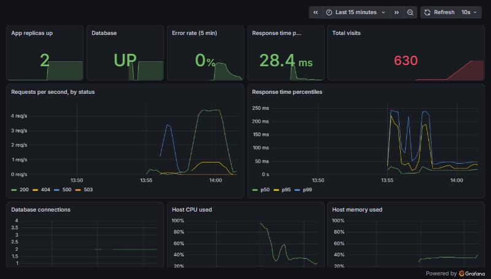
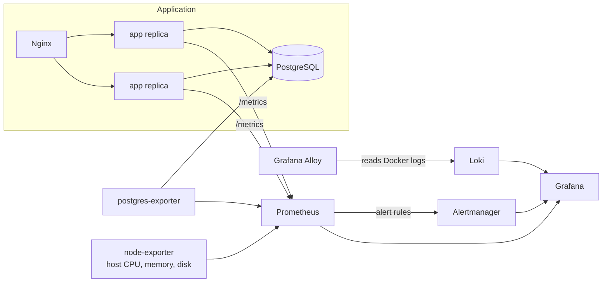

# Observability stack

[](https://github.com/MrHamdiChedli/observability-stack/actions/workflows/ci.yml)

Monitoring, alerting and centralized logs for the visit counter, built as code:
**Prometheus** collects metrics, **Alertmanager** handles alerts, **Grafana** shows dashboards, and **Loki** with **Grafana Alloy** gathers the logs of every container.
A test stops the database for real and proves that the alerts fire, then resolve.



*The dashboard right after the end-to-end test: the blue line is the 500 errors while the database was stopped, and traffic returns to 200 once it restarts.*



## What the tests prove

[tests/observability-test.sh](tests/observability-test.sh), on the running stack:

```
1. Prometheus scrapes all 6 targets (2 app replicas, postgres, node, prometheus, alertmanager)
2. App requests are counted
3. Grafana has its data sources and the dashboard
4. Container logs reach Loki
5. No alert is firing while everything is healthy
6. Stopping the database fires DatabaseDown and HighErrorRate
7. Restarting the database resolves DatabaseDown
PASS: all checks succeeded
```

The alert rules also have **unit tests** ([prometheus/tests/alerts_test.yml](prometheus/tests/alerts_test.yml)), run with `promtool test rules`: each alert is fed made-up time series and must fire at the right moment and stay quiet otherwise (for example, `HighErrorRate` fires at 20% errors and not at 2%).

## The app's metrics

The app exposes `/metrics` with the [Prometheus Python client](app/app.py):

| Metric | Labels | Used for |
|--------|--------|----------|
| `http_requests_total` | method, endpoint, status | Requests per second, error rate |
| `http_request_duration_seconds` | endpoint | p50 / p95 / p99 response time |

- **Bounded cardinality**: the `endpoint` label is the route pattern, and every unknown URL is labelled `unknown`. A bot scanning random URLs can't create thousands of time series.
- **One Gunicorn process with 4 threads**: Prometheus counters live in process memory. With several worker processes, each scrape would land on a random one and the counters would jump around.

## Alerts

| Alert | Fires when | Severity |
|-------|-----------|----------|
| `AppDown` | No app replica can be scraped for 30s | critical |
| `AppReplicaMissing` | Fewer than 2 replicas for 1 minute | warning |
| `DatabaseDown` | The exporter can't reach PostgreSQL for 15s | critical |
| `HighErrorRate` | More than 5% of requests return 5xx for 30s | critical |
| `HighLatency` | p95 response time above 500 ms for 5 minutes | warning |
| `HostDiskAlmostFull` | Less than 10% disk left for 10 minutes | warning |

Alertmanager groups alerts by name, sends critical ones without waiting, and **inhibits** `AppReplicaMissing` while `AppDown` fires, so a single incident doesn't produce two pages. Connecting a real receiver (email, Slack, PagerDuty) is one block in [alertmanager.yml](alertmanager/alertmanager.yml).

## Everything is code

| File | Defines |
|------|---------|
| [prometheus/prometheus.yml](prometheus/prometheus.yml) | Scrape targets. App replicas are found through Docker's DNS, so scaling up needs no config change |
| [prometheus/rules/alerts.yml](prometheus/rules/alerts.yml) | Alert rules |
| [grafana/provisioning/](grafana/provisioning) | Data sources (Prometheus, Loki, Alertmanager) and the dashboard provider |
| [grafana/dashboards/visit-counter.json](grafana/dashboards/visit-counter.json) | The dashboard: replicas, database, errors, latency, traffic, host and logs |
| [alloy/config.alloy](alloy/config.alloy) | Log collection, labelled by Compose service |
| [loki/loki.yml](loki/loki.yml) | Log storage with 7-day retention |

No click in a UI is needed: `docker compose up` gives the full setup. Grafana's admin password is generated on first run and passed as a Docker secret.

## Run it

```bash
bash scripts/init-secrets.sh
docker compose up --detach --build --wait
bash tests/observability-test.sh
```

| UI | URL |
|----|-----|
| App | http://localhost:8080 |
| Grafana | http://localhost:3000 (user `admin`, password in `secrets/grafana_admin_password.txt`) |
| Prometheus | http://localhost:9090 |
| Alertmanager | http://localhost:9093 |

Without Docker, `vagrant up` creates a VM (192.168.56.50) that does all of the above.

## CI

On every push, GitHub Actions checks the Prometheus config and rules (`promtool`), runs the alert unit tests, checks the Alertmanager config (`amtool`), the Alloy config and the Compose file, lints the code, then starts the whole stack and runs the end-to-end test, database outage included.

## Problem hit while building it

- **A wrong assumption about `absent()`.** I expected `AppDown` to carry the label `job="app"`, because `absent()` copies labels from the selector. The alert unit tests proved me wrong: it only does that for a plain selector, not for an expression like `up{job="app"} == 1`. Without the unit tests, a Slack route matching `job="app"` would have silently never received this alert.
